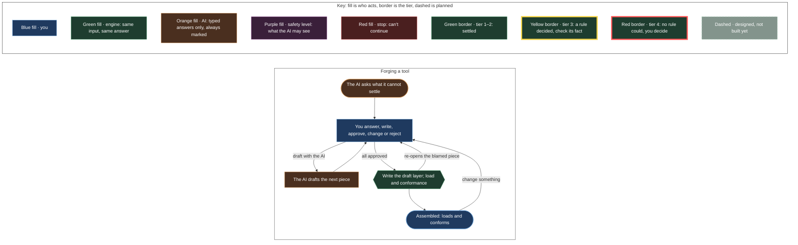

<!-- generated by tools/generate_protocol_doc.py — do not edit -->

# The forging protocol

**Generated from `mendel_forge/forging/protocol.py`**, declared on the same engine as the builder's, so this picture is the machine. Who may do what to each item is in `mendel_forge/forging/rules.py`; the design is [forge MVP 3](../../superpowers/specs/2026-10-30-forge-3-forging-design.md).

