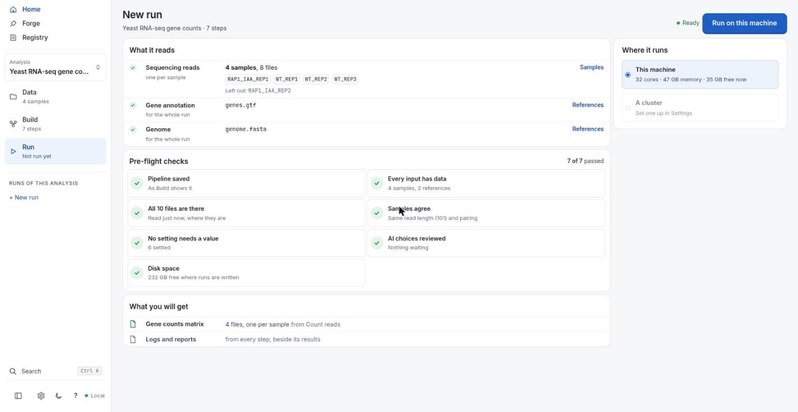
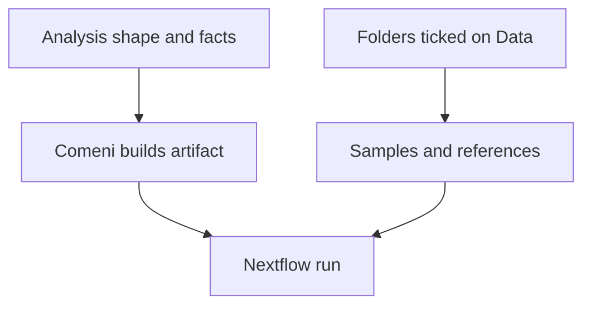

# Inputs in the alpha

Inputs are the most important moving surface in the alpha. This page explains what happens
today, what is expected to change, and what concept should stay stable.

## The stable concept

Comeni chooses a pipeline from the analysis shape and data facts. Local file paths enter later,
when you run the pipeline.

For the RNA-seq example, these are different kinds of information:

| Kind | Example | Used for |
|---|---|---|
| Analysis shape | “gene counts from paired-end RNA-seq” | choosing the pipeline structure |
| Data fact | `read_length: 150` | applying rules such as STAR vs HISAT2 |
| Run input | `data/*_R{1,2}.fastq.gz` | executing this pipeline on this machine |

The app should not need your FASTQ path to decide that an aligner is required. It may need read
length, strandedness, organism, or other facts to decide which aligner and settings are
defensible.

## Current alpha behavior

You tick the folders that hold your data on **Data**. Comeni reads the start of each file where
it is, groups the files into samples, measures facts such as read length, and lists references
such as a genome or an annotation. When you press **Run**, the **New run** page answers each of
the pipeline's inputs from that data: no path is typed, and the run reads the same files where
they are.

For the shared [RNA-seq example](../tutorials/rnaseq-example.md), Data holds:

| Input | Example |
|---|---|
| Reads | the samples read from `*_R1.fastq.gz` and `*_R2.fastq.gz`, paired by name |
| Genome FASTA | `reference/genome.fasta`, added as the genome on Data → References |
| Annotation GTF | `reference/genes.gtf`, added as the annotation |

The folders must be under the data folders this installation reads; see
[Add your data](../how-to/pipelines/add-your-data.md).

## Expected to change

Some inputs are not answered from Data yet: a table of several items, a sample spread over
several lanes, and columns that relate samples to each other. New run names them as missing; the
emitted pipeline still accepts them when run as plain Nextflow with a samplesheet. Reusing known
reference sets ("standard references") is planned.

## Where does my data go?

Comeni builds and records the workflow. Nextflow runs it where you point the run. In the local
alpha stack, the run service launches Nextflow against the files Data read, where they are.

The key boundary is:

Pipeline construction uses analysis descriptions, registry declarations and data facts.
You can state facts yourself, or tick the folders that hold your data: Comeni reads the start
of each file where it is, never copying it, and derives the facts from what it measured. The
same files are what a run reads.

To add data, see [Add your data](../how-to/pipelines/add-your-data.md).

## Practical checks

| Question | Answer |
|---|---|
| Do I upload files to design a pipeline? | No. You tick folders on this machine; files are read where they are. |
| Do I provide paths to run locally? | No. A run's inputs come from the analysis's data. |
| Can the same artifact run twice? | yes, a run is one execution of an artifact |
| Can inputs change without changing the pipeline? | yes, when the scientific shape and decisions stay the same |

Next: [Running pipelines](../how-to/pipelines/run.md) explains the launch path.

## Builder input direction

The builder is already the main product surface, but some details are expected to change:
natural-language goal entry, input collection, and run submission are still being shaped. Learn
the loop and the evidence model; do not treat the current input form as a stable external API.
The intended MVP keeps the common path linear and makes collections of input files visible
without requiring one graph branch per file. General workflow branching can grow from that
model later.
