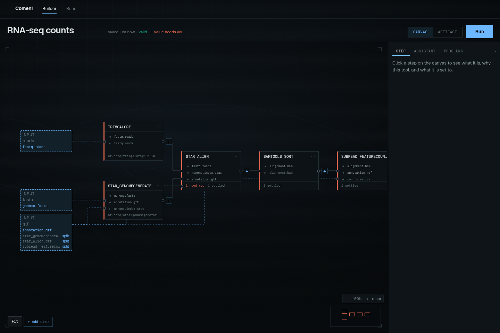
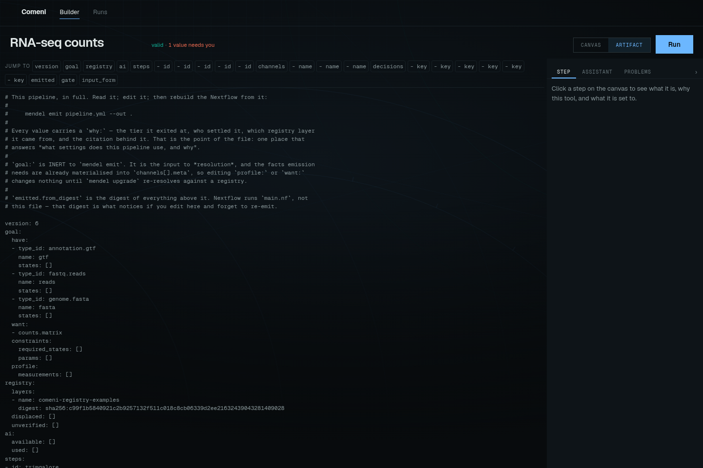

# Build and inspect a pipeline

Use the builder to inspect steps, review their settings and save a pipeline artifact.
You can open the manual builder at `/build`, or use the authoring conversation when a
model is configured.

The draft is a **living pipeline**: it develops as you describe the analysis, consider choices,
and change steps or settings. The conversation and canvas should remain two views of that one
draft, while the artifact remains its durable record.

A draft is the editable graph. An artifact is the saved pipeline record behind it. See
[Core words](../../explanation/pipeline-concepts.md) if those terms are new.

## Inspect and review the draft

1. Open `/build` or click **New pipeline** from the home page.
2. Inspect the draft that opens.
3. Select a step to see its ports, settings, and reasons.
4. Answer red decisions before relying on the pipeline.
5. Use **Artifact** to see the materialized pipeline record.
6. Press **Run** when the status line is clean enough for the gate you intend to run.

## Inspect the aligner in the RNA-seq example

Using the shared [RNA-seq example](../../tutorials/rnaseq-example.md), select the aligner step. In the current
registry this is usually `STAR align` for 150 bp reads.

Read the step in three passes:

| Pass | What to check | Example |
|---|---|---|
| Ports | whether the step consumes and produces the right biological objects | reads and genome index in, BAM out |
| Settings | whether any value still needs a person | `seq_platform` may be unanswered |
| Reason | why this implementation was chosen | read length matched the STAR rule |

Check the evidence behind the selection and whether a different premise would change it.

## Canvas and artifact

The canvas is for working. The artifact is for review.

When something looks surprising on the canvas, open **Artifact** and find the same step in
`pipeline.yml`. The artifact should name the selected contract, settings, decision tiers, and
provenance. If the app and artifact disagree, treat the artifact as the durable record and the
UI as suspect.

## Where the science enters

Tools, types, measurements, and rules come from the registry. If the builder cannot choose a
tool or asks a question the lab can answer with a rule, the fix usually belongs in the
[Registry](../../explanation/registry.md), not in a one-off graph edit.

For control and status definitions, see [Builder interface](../../reference/pipelines/builder-interface.md).
To answer a data question using a file, follow [Answer with a sample](answer-with-sample.md).
