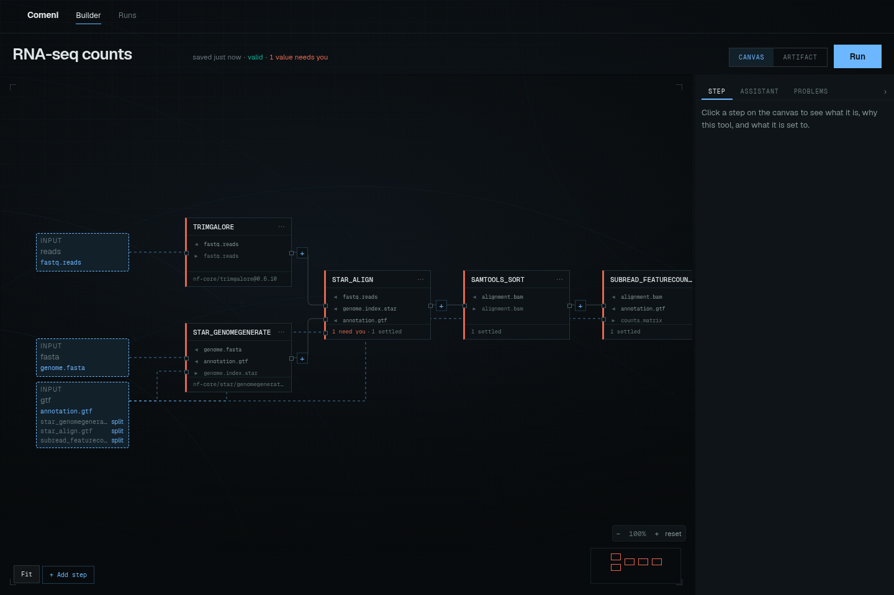
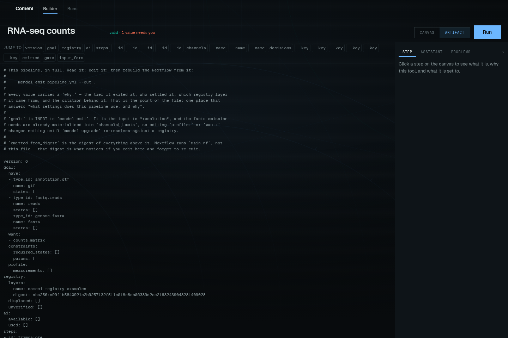

# Build and inspect a pipeline

Use the builder to inspect steps, review their settings and save a pipeline artifact.
Every pipeline opens in the same builder: a conversation beside a canvas. With a model
configured you can start by describing the analysis; without one, start by drawing at `/build`.

The draft is a **living pipeline**: it develops as you describe the analysis, consider choices,
and change steps or settings. The conversation and canvas should remain two views of that one
draft, while the artifact remains its durable record.

A draft is the editable graph. An artifact is the saved pipeline record behind it. See
[Core words](../../explanation/pipeline-concepts.md) if those terms are new.

## Inspect and review the draft

1. Open a pipeline from the home page, or click **New analysis**.
2. Inspect the canvas and the step line beside it.
3. Select a step to see its ports, settings, and reasons.
4. Answer red decisions before relying on the pipeline.
5. Use **Pipeline file** to see the materialized pipeline record.
6. Press **Run** when nothing needs you.

## Change it by hand

Add a step, remove one, swap its tool, or drag a wire between two ports. The engine reads what
the change means and asks under **From your edit**, for example *So you never want trimming
here — right?* Answer **Yes** and it becomes your decision: the engine plans around it on every
later change, and steps that depend on it are reviewed again. Answer **No, undo** and nothing
changes. When the engine cannot honour a change (you excluded the only tool that can make
something), it says so with a code and keeps nothing.

To start without a model, open **New analysis** and add the step that makes what you want, such
as featureCounts for gene counts. After you confirm it, the engine asks which inputs you have,
shows what it understood, and offers the steps it needs one at a time.

## Optional inputs

Some tools can run with or without an input — QUAST runs on assemblies alone, and adds
misassembly reports when it also gets a reference genome. On the canvas, such an input is drawn
dashed. Open the step to see its **Optional inputs**: each says what it adds and is one of:

- **Off** — the pipeline does not take it. This is where every optional input starts.
- **Optional** — the pipeline takes it, and each run may supply the file or leave it empty.
- **Required** — every run supplies it.

Switching one is your decision, kept with its history like any other. You can also say it in
the conversation (*check my assemblies against the K-12 reference*): the assistant proposes the
switch, and it waits for your click unless your own words said it. The engine never switches an
input on by itself; it only makes one required when a later step needs what it adds, and says
why. If a tool's rules tie inputs together (QUAST reads a GFF only with a reference), switching
one brings the other, and the step says so.

## Inspect the aligner in the RNA-seq example

Using the shared [RNA-seq example](../../tutorials/rnaseq-example.md), select the aligner step. In the current
registry this is usually `STAR align` for 150 bp reads.

Read the step in three passes:

| Pass | What to check | Example |
|---|---|---|
| Ports | whether the step consumes and produces the right biological objects | reads and genome index in, BAM out |
| Settings | whether any value still needs a person | `seq_platform` may be unanswered |
| Reason | why this implementation was chosen | read length matched the STAR rule |

Check the evidence behind the selection and whether a different premise would change it.

## Canvas and artifact

The canvas is for working. The artifact is for review.

When something looks surprising on the canvas, open **Artifact** and find the same step in
`pipeline.yml`. The artifact should name the selected contract, settings, decision tiers, and
provenance. If the app and artifact disagree, treat the artifact as the durable record and the
UI as suspect.

## Where the science enters

Tools, types, measurements, and rules come from the registry. If the builder cannot choose a
tool or asks a question the lab can answer with a rule, the fix usually belongs in the
[Registry](../../explanation/registry.md), not in a one-off graph edit.

For control and status definitions, see [Builder interface](../../reference/pipelines/builder-interface.md).
To answer a data question using a file, follow [Answer with a sample](answer-with-sample.md).
