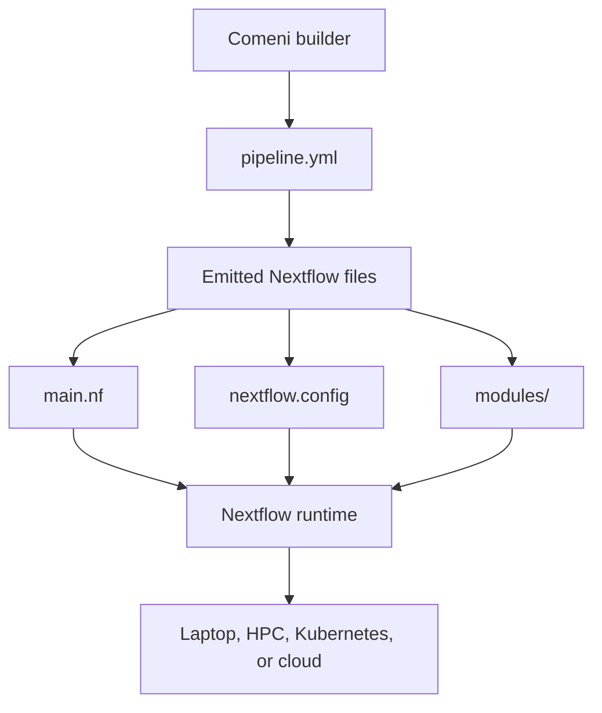
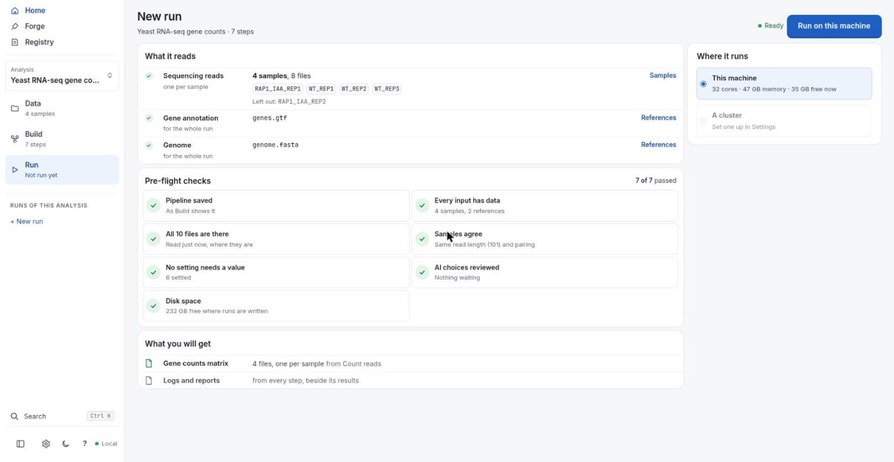

# Running pipelines

Comeni builds a pipeline artifact; Nextflow runs it. The local alpha stack can launch a run
from the app, and the emitted files can also be taken to the environment where your lab already
runs Nextflow.

If the lifecycle terms are not clear yet, start with [Core words](../../explanation/pipeline-concepts.md).



## Run from the app

Open **Run** in the analysis. Its first page is **New run**: it shows what the run will read, the
checks that must pass first, what you will get, and where it runs.



- **What it reads** lists each input the pipeline takes, answered from **Data**: the samples, with
  any you left out named, and each reference. No path is typed; the run reads the files where
  they are.
- **Pre-flight checks** cover the saved pipeline, that every input has data, that every file is
  still there, that the samples agree, that no setting still needs a value, that the AI's choices
  have been reviewed, and the disk space where runs are written. After a first run, a memory
  check compares what each step asked for with what this machine has. A check that fails links to
  where you fix it.
- **What you will get** lists the results by the step that makes them.

Press **Run on this machine**. The app keeps the pipeline as it is in Build, runs the lint gate,
and sends it to the local run service, which launches Nextflow. The run then has its own pages:
**Overview** (samples finished, the pipeline as Build draws it with each step's progress, and the
cores and memory it reserved and the cores it used), **Steps**, **Outputs** and **Console**
(Nextflow's own terminal and a shell in the run's folder).

### When your samples differ

If a fact differs between your samples and nothing measured it (strandedness, say), add a column
for it on **Data**, named for the fact, and fill each sample's value. The run takes the pipeline's
value for each sample from that column, and the pipeline checks every row before it processes
any sample.

An input the pipeline takes as **optional** and that Data does not answer is sent empty, and the
tool runs without it. When optional inputs depend on each other, the pipeline checks that rule
again when it starts.

Not yet answered from Data: an input that is a table of several items (such as a set of
databases), a sample that spans several lanes, and columns that relate samples to each other
(such as `patient` or `control`). New run names such an input as missing and holds the run. The
emitted pipeline still accepts them when you [run it as plain Nextflow](#run-as-plain-nextflow)
with a samplesheet.

The input model is explained in [Inputs in the alpha](../../explanation/inputs-and-data.md).

## Current alpha behavior

| Step | What happens today |
|---|---|
| New run | the app answers each input from Data and runs the pre-flight checks |
| Keep | the pipeline is written as an artifact, as Build shows it |
| Lint gate | the app checks the artifact before it is sent |
| Send | the local run service launches Nextflow from the artifact, on this machine |

## Expected to change

Running on a cluster is shown and not yet available; it will be set up in Settings. Inputs that
Data cannot answer yet (tables, lanes, relations between samples) are expected to come to Data.

The stable concept is the boundary: Comeni decides and records the pipeline before local paths
enter the run.

## Run as plain Nextflow

The artifact contains the Nextflow files and vendored modules needed to run outside the app.
That is the portability boundary: Comeni helps create and justify the workflow, while Nextflow
executes it on the target system.

For execution backends and production Nextflow configuration, use the official Nextflow and
Seqera documentation alongside the emitted files.

The app path does this for you locally. The equivalent shape outside the app is:

```bash
cd exported-pipeline
nextflow run main.nf -profile docker \
  --input 'data/*_R{1,2}.fastq.gz' \
  --fasta reference/genome.fa \
  --gtf reference/genes.gtf
```

Treat that command as illustrative. The exact parameter names come from the emitted
`nextflow.config` and the pipeline artifact you are running.

If you are handing the pipeline to someone else, hand over the artifact directory rather than a
memory of the builder screen. The artifact is the portable record.

## Before relying on a run

Run a gate appropriate to the evidence you need. A lint or preview gate checks different things
from a test gate on real data. A successful gate is evidence only for what that gate actually
exercised.

For the local containers and development commands, see [Local development stack](../development/local-stack.md).

Next: use [Watching runs](watch.md) to interpret what happens after submission.
