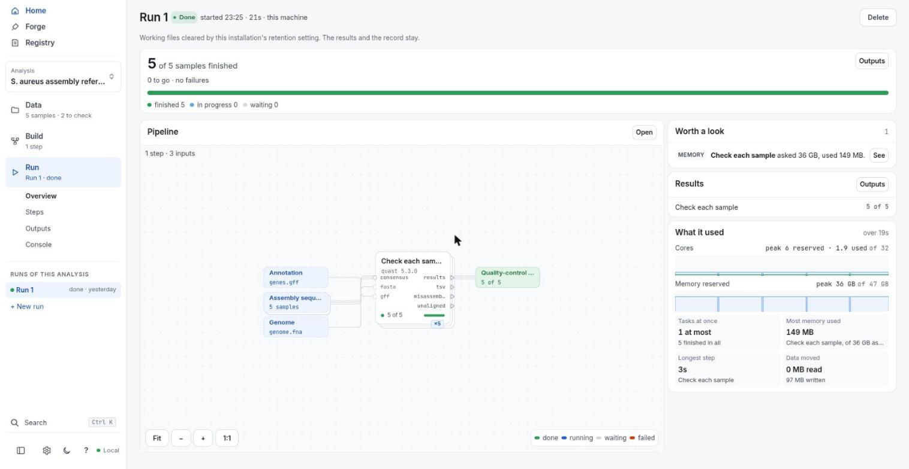

# Watching runs

A run's pages turn Nextflow's events into a lab-readable view of what happened. Use them to answer
the practical questions first: is work still moving, what failed, what retried, and where is the
evidence?

## Find a run

Runs belong to their analysis. Open the analysis, then **Run**: the rail lists **Runs of this
analysis**, newest first, each with its state. **Home** lists analyses that need you, including
a run that went wrong. A new run opens on its Overview as soon as it is sent.

## One run

| Page | What it answers |
|---|---|
| Overview | how many samples have finished; the pipeline as Build draws it, each step with its progress; what is worth a look (a step that asked for far more memory than it used, retries, failures); results so far; and the cores and memory the run reserved and the cores it used |
| Steps | when each step ran, task by task, and each task's attempts |
| Outputs | what the run published, by the step that made it; **Open** shows a file in a new tab |
| Console | Nextflow's own terminal output, a shell in the run's folder, a searchable list of commands, and the assistant |

While the run is going, Overview's machine card is titled **Now**; once it is over it becomes
**What it used**, with each figure's peak.

The Console's shell has full access to this machine, as the run did. The assistant on Console sees
what the console and shell show, with paths shortened. It may run commands that only read files
inside the run's folder itself, and shows you each one; anything else it suggests, you run.

## Healthy run example

For the shared [RNA-seq example](../../tutorials/rnaseq-example.md), a healthy run moves through its
states without needing you to inspect every task:

| What you see | Meaning |
|---|---|
| state is **Running** | Nextflow has accepted the work and tasks are reporting |
| samples finished go up | the event stream is still moving |
| on a second run, steps finish almost at once | Nextflow reused finished tasks from the previous run; they count as done |
| state becomes **Done** | every required task completed |

The Overview answers "is the run broadly okay?" before Steps answers "what happened to each unit
of work?"

## Failed runs

When a run goes wrong, its Overview and Console say which step failed and why. Console's banner
names the failed task, opens its folder in the shell, and offers **Resume the run**, which runs
the same command Nextflow ran with `-resume`, so finished tasks are kept.

| Symptom | First place to look | Why |
|---|---|---|
| one step failed | Overview's *Worth a look*, then Console | it names the task, its exit and its attempts |
| many tasks failed immediately | Console | launch or input errors show there first |
| tasks keep retrying | Steps | each task's attempts show resource escalation or repeated failure |
| no task reports for a long time | Overview's machine card and Steps | the run may be queued, stalled, or unable to reach the executor |

Do not start by reading raw logs line by line. Start from the folded state, then drill down.

Next: if the failure was caused by a missing tool, go to
[Writing a contract](../registry/add-tool.md); for a wrong convention or a repeated manual
answer, go to [Making a choice depend on your data](../registry/write-rule.md).

## Alpha note

Runs go to this machine. Running on a cluster is shown in New run and not yet available. Memory
*used* over time is not drawn: Nextflow reports one peak per task, and adding peaks together would
draw a moment that never happened.
