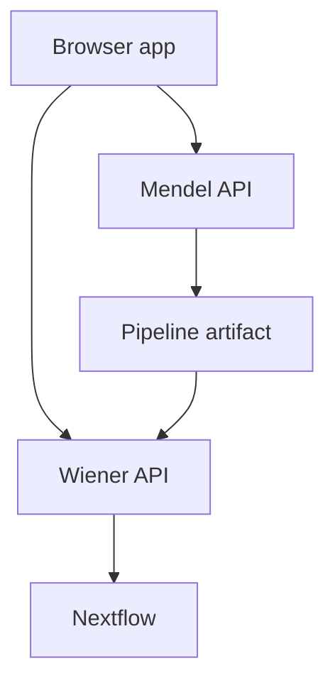

# Development services

| Container | Job |
|---|---|
| `api` | Mendel API: drafts, build service, registry-backed decisions |
| `mendel-worker` | long Mendel jobs over Redis |
| `ai-worker` | the only container that calls a model. Idle until one is configured |
| `ollama` | a local model server. Opt-in — `make ai-up` |
| `web` | nginx for the built SPA and `/api` proxy |
| `postgres`, `redis` | Mendel database and queue |
| `wiener-api` | run launch and run queries |
| `wiener-ingest`, `wiener-worker` | ingest and fold Nextflow events |
| `wiener-postgres` | Wiener database and migration chain |
| `otel-collector`, `clickhouse`, `grafana` | optional local telemetry; start with `make telemetry` |
| `wiki` | mkdocs serving these pages, reloading as you edit them |

Mendel builds and explains pipeline artifacts. Wiener launches and observes runs. The browser
carries a pipeline artifact between them; the two services are not one combined backend.

Start and stop them using the [local stack guide](../how-to/development/local-stack.md).
