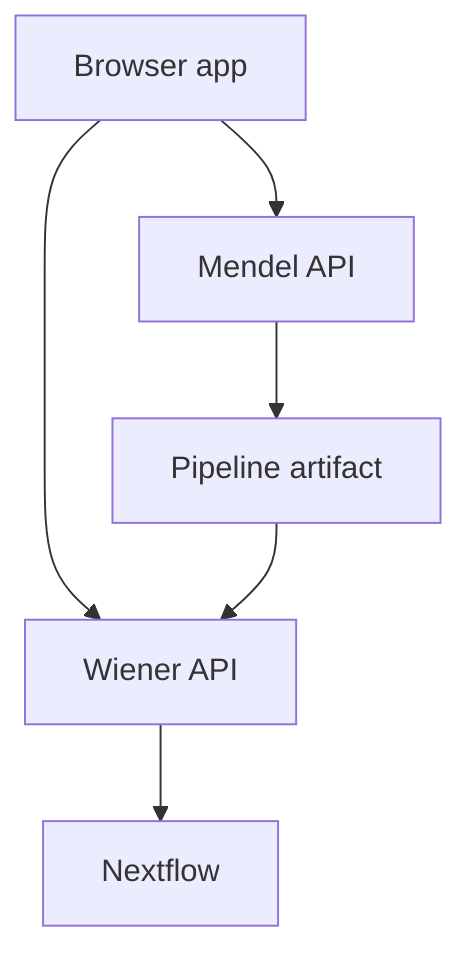

# Development services

| Container | Job |
|---|---|
| `api` | Mendel API: drafts, build service, registry-backed decisions |
| `mendel-worker` | long Mendel jobs over Redis |
| `ai-worker` | the only container that calls a model. Idle until one is configured |
| `ollama` | a local model server. Opt-in — `make ai-up` |
| `web` | nginx for the built SPA and `/api` proxy |
| `postgres` | Shared PostgreSQL server; separate Mendel/Wiener databases, roles and migrations |
| `redis` | Mendel queues on database 0; Wiener jobs and streams on database 1 |
| `wiener-api` | run launch and run queries |
| `wiener-ingest`, `wiener-worker` | ingest and fold Nextflow events |
| `otel-collector`, `clickhouse`, `grafana` | optional local telemetry; start with `make telemetry` |
| `wiki` | mkdocs serving these pages, reloading as you edit them |

Mendel builds and explains pipeline artifacts. Wiener launches and observes runs. The browser
carries a pipeline artifact between them; the two services are not one combined backend.

Start and stop them using the [local stack guide](../how-to/development/local-stack.md).

PostgreSQL publishes only `127.0.0.1:5432` by default in development; both databases use
that port. `DB_HOST_PORT` changes it. Production keeps the server internal. Deployment and
existing-data migration are documented in the [PostgreSQL operations guide](https://github.com/comeni-project/Comeni-Labs/blob/main/ops/postgres/README.md).
