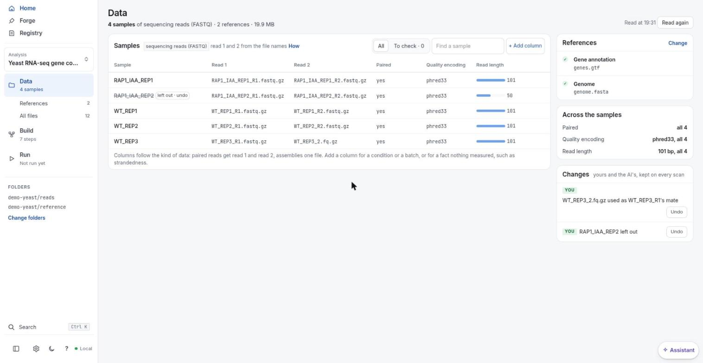
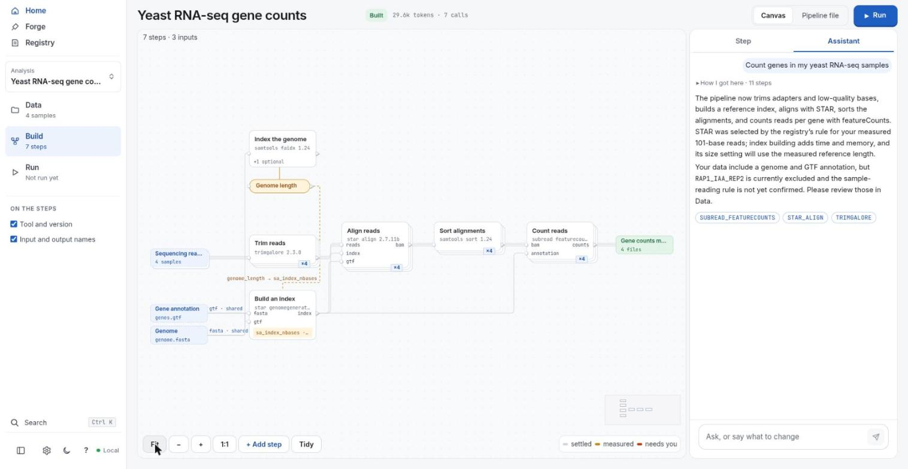
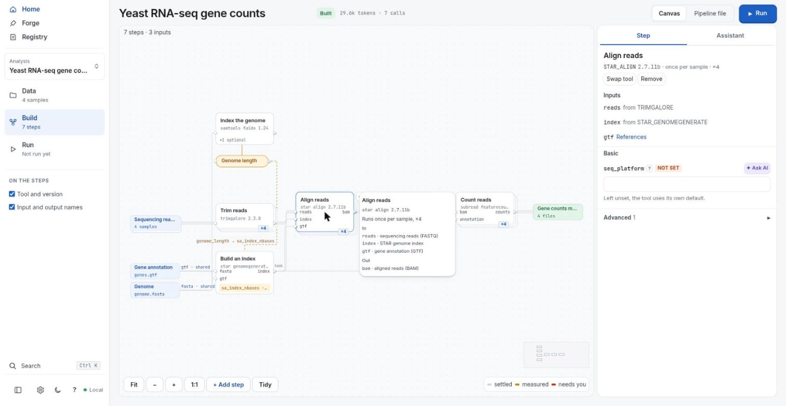
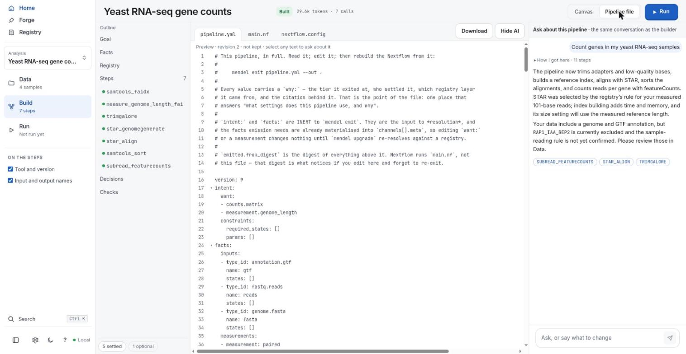
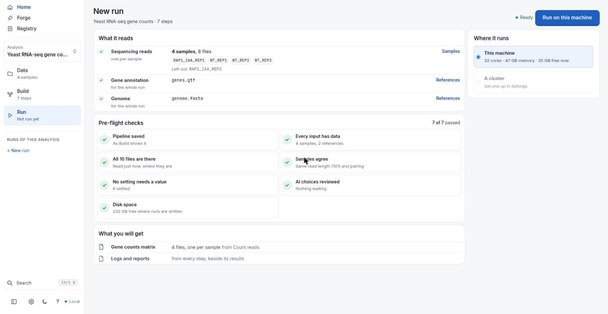
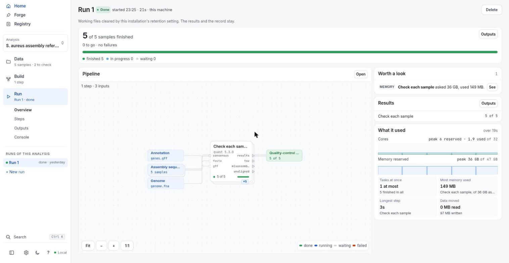

# Your first pipeline

You will ask a question, point Comeni at your data, inspect the pipeline it builds, review its
decisions, run it, and watch the run.

This walkthrough uses the shared [RNA-seq example](rnaseq-example.md): gene counts from
paired-end RNA-seq reads. A copy of real yeast data for it can be downloaded with
`python3 tools/demo_data.py` (see the [demo walk](../how-to/development/demo-walk.md)).

If the words draft, artifact, gate, run, or registry are new, read [Core words](../explanation/pipeline-concepts.md)
first. It is short and will make this walkthrough easier.

## 1. Ask your question

If the stack is not running yet, follow [Install and open the app](../how-to/install.md).
Then open [http://localhost:5173](http://localhost:5173).

**Home** asks *What do you want to find out?* Type the question, for example *Count genes in my
yeast RNA-seq samples*, and press Enter. A new analysis opens on its **Data** page. With a model
configured, the builder agent starts at once and asks for the data if it has none.

Without a model, open **Build** in the analysis and click **+ Add step**: choose
**SUBREAD_FEATURECOUNTS**, the step that makes gene counts, and the engine builds the rest of the
pipeline from the registry's rules.

## 2. Add your data

On **Data**, tick the folders that hold your reads and your reference, then press **Read these
folders**. Each folder says what its files look like before you tick it. Comeni reads the start
of each file where it is, never copying it: it groups the files into samples, measures facts such
as read length and pairing, and lists the genome and annotation files as candidate references.



**Check these** lists anything that looks wrong, from what was measured: a read 1 with no read 2,
or a sample whose read length differs from the rest. Each has a fix you choose. On **References**,
choose the genome and the annotation the pipeline needs. Adding data is described in full in
[Add your data](../how-to/pipelines/add-your-data.md).

## 3. Inspect the pipeline

Open **Build**. The canvas shows the whole pipeline; the assistant beside it says what it built and
why. Treat the screen as three questions:

| Question | Where to look |
|---|---|
| What steps are in this pipeline? | the canvas |
| What does each step consume and produce? | the ports: inputs are circles, outputs triangles |
| What still needs a person? | the step's tags and its card |



For the RNA-seq example, expect a graph shaped like this:

```text
fastq.reads
  -> Trim Galore
  -> STAR align
  -> samtools sort
  -> featureCounts
  -> counts.matrix[gene_level]

genome.fasta + annotation.gtf
  -> STAR genomeGenerate
  -> STAR align
```

The exact layout may move as the builder changes, but the scientific chain should remain
recognizable: prepare reads, prepare the index, align, sort, count.

## 4. Read the decisions

Click a step to open its card. Settings carry their source: a rule, a measured fact, the AI or
you. A setting nothing could settle says **NOT SET**; each setting says what it is behind its
**(?)**.



Comeni may assist, but it must not hide a guess as if it were a scientific decision. For the full
ladder, read [Reviewing decisions](../how-to/pipelines/review.md).

In this example, the decision story should look like this:

| Decision | Why it is there | What you do |
|---|---|---|
| Trim Galore | structural when it is the only compatible producer | scan it |
| STAR align | data-backed rule: the measured read length matches the STAR rule | check the read-length premise |
| samtools sort | structural when it is the only compatible producer of the required sorted BAM | scan it |
| featureCounts | structural when it is the only compatible producer of gene-level counts | scan it |
| `seq_platform` | ambiguous: no declared fact proves the platform | answer it, or leave it unset and the tool uses its own default |

That last row is not a failure. It is the system refusing to guess a platform fact it cannot
defend.

## 5. Open the pipeline file

Switch from **Canvas** to **Pipeline file**. It shows the materialized pipeline record, the bridge
between the app and plain Nextflow.

| File | Meaning |
|---|---|
| `pipeline.yml` | the saved pipeline: goal, facts, steps, settings and why each was chosen |
| `main.nf` | emitted Nextflow workflow |
| `nextflow.config` | execution configuration and declared inputs |



Read the artifact as the evidence record. The app is the easier way to work with it, but the file
is what makes the pipeline portable and reviewable outside the app.

## 6. Run it

Press **Run**. **New run** shows what the run will read from Data, the pre-flight checks, what you
will get and where it runs. When the checks pass, press **Run on this machine**. No path is typed:
the run reads the files Data read, where they are. The details are in
[Running pipelines](../how-to/pipelines/run.md).



## 7. Watch it

The run opens on its **Overview**: samples finished, the pipeline with each step's progress,
anything worth a look, and the cores and memory the run reserved and used. **Steps**, **Outputs**
and **Console** hold the detail.



| If you see | Start with |
|---|---|
| Running tasks but no completions | Overview's machine card and Steps |
| One failed step | Overview's *Worth a look*, then Console |
| Many retries | Steps, filtered to retried tasks |
| Missing input errors | Console, and the inputs on Data |

## What you learned

- Comeni is app-first and low-code; the CLI is not the main user path.
- Your data is read where it is, and its measured facts steer the pipeline's choices.
- The graph is editable, but the artifact is the durable record.
- Decisions are labeled by how they were justified.
- The output is still Nextflow, so your lab can run it outside Comeni.

Next: [The product loop](../explanation/pipeline-lifecycle.md), [The builder](../how-to/pipelines/build.md), and
[Watching runs](../how-to/pipelines/watch.md).
